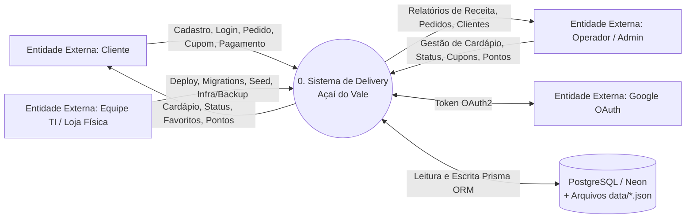
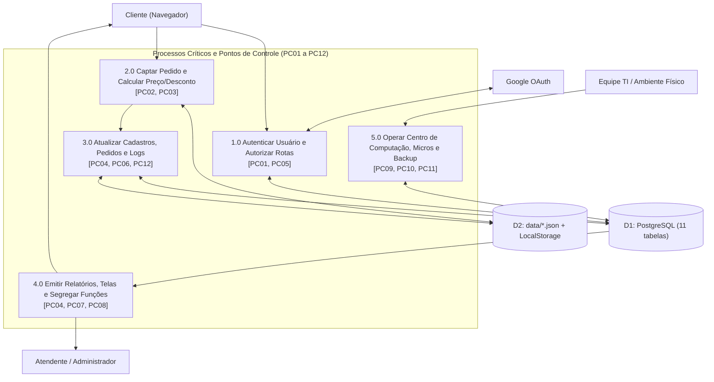

# Plano Mestre de Auditoria de Sistemas — Projeto Açaí do Vale (Metodologia Prof. Eduardo Pelli)

**Disciplina:** Segurança e Auditoria de Sistemas de Informação (SASI) — UFVJM (Prof. Eduardo Pelli)  
**Sistema Auditado:** Açaí do Vale (`acai_api/delivery-main` — TPIII)  
**Data de Execução:** 24/11/2026 | **Entrega Classroom e Apresentação (≤ 15 min):** 25/11/2026 (`GRUPO_X.pdf`, máx. 20 páginas)  
**Líder da Equipe (Pessoa 1):** Augusto Henrique

---

## 1. Planejamento da Auditoria (6 Passos — Slides 18 e 19)

### 1º Passo: Conhecer o Ambiente Auditado e DFD Top-Down
- **Fluxo de Processamento:** Entrada via interface web Next.js 15 (cadastro/login e montagem de açaí em `PedidoContext`/`localStorage`), processamento paralelo em duas camadas de API (`/api/*` legada acoplada ao Prisma e `/api/v1/*` em Clean Architecture/DDD) e saída em consultas de status, extrato de fidelidade e painéis administrativos.
- **Recursos Humanos do Auditado:** 6 integrantes de desenvolvimento (~346h declaradas em `docs/TEAM_CONTRIBUTION.md`) e operadores de loja controlados apenas por uma flag booleana `Cliente.isAdmin`, sem DBA (Administrador de Dados) nem Analista de Segurança da Informação formalizados.
- **Recursos Materiais e Software:** Hospedagem Vercel, banco Neon PostgreSQL, containers Docker (`postgres:16-alpine` e `node:20-alpine`), Next.js 15.5.7, React 19.2.1, Prisma 6.19.0, NextAuth 4.24.11, `bcryptjs` 3.0.2, `jsonwebtoken` 9.0.2, Jest 30.2 e testes Java 17/Maven.
- **Arquivos Processados:** 11 modelos no PostgreSQL (`Cliente`, `Pedido`, `Sabor`, `Adicional`, `PedidoSabor`, `PedidoAdicional`, `Cupom`, `Favorito`, `FavoritoSabor`, `FavoritoAdicional`, `FidelidadeTransacao`), 4 arquivos JSON planos residuais em `/data` e `localStorage` no navegador.
- **Telas (14) e Relatórios (4):** 11 telas de cliente + 3 painéis administrativos (`/dashboard`, `/dashboard/pedidos` e `/ui/admin`), gerando KPIs de Receita Total (`DashboardStats`), monitor de entregas, extrato de fidelidade e histórico de pedidos (`/pedidos/acompanhar`).

#### DFD Nível 0 (Contexto)

#### DFD Nível 1 (Top-Down com Pontos de Controle no Nível de Processos — Slide 6, Deck 1)

---

### 2º, 4º, 5º e 6º Passos: Pontos de Controle, Critérios, Grau de Risco (1–5) e Hierarquização

- **Escala Oficial de Grau de Risco (Slide 19, Deck 3):**
  `1 – Muito Fraco` | `2 – Fraco` | `3 – Regular` | `4 – Forte` | `5 – Muito forte` *(quanto maior a nota, maior o risco e a prioridade de atuação)*.
- **Critérios de Risco (4º Passo):** Impacto financeiro/operacional, violação dos 8 parâmetros de controle interno (fidelidade, segurança física, segurança lógica, confidencialidade, legislação/LGPD, eficiência, eficácia e regras de negócio) e facilidade de exploração.

| Ordem | PC | Ponto de Controle Auditado | Parâmetro de Controle Interno | Responsável | Grau de Risco |
| :---: | :---: | :--- | :--- | :--- | :---: |
| **1º** | **PC01** | Controle de Acesso ao Teleprocessamento/APIs e Rotas Admin (`/api/*`, `/seed`, `/create-admin`) | Segurança Lógica | **P3 (`[A definir]`)** | **5 – Muito forte** |
| **2º** | **PC02** | Programas de Cálculo e Crítica de Entrada de Pedidos (`valorTotal` enviado pelo cliente) | Fidelidade & Regras de Negócio | **P4 (Helen)** | **5 – Muito forte** |
| **3º** | **PC03** | Rotinas de Atualização de Cupons Promocionais e Saldo de Fidelidade (`/coupons`, `/loyalty`) | Regras de Negócio & Segurança Lógica | **P4 (Helen)** | **5 – Muito forte** |
| **4º** | **PC04** | Confidencialidade de Telas/Consultas (`/ui/admin` aberto, `/acompanhar` e `PUT /api/clientes`) | Confidencialidade & Legislação (LGPD) | **P5 (`[A definir]`)** | **4 – Forte** |
| **5º** | **PC05** | Gestão de Passwords, Sessões JWT/OAuth e Segurança em Redes | Segurança Lógica & Confidencialidade | **P3 (`[A definir]`)** | **4 – Forte** |
| **6º** | **PC06** | Fidelidade da Informação, *Audit Trail* (Logs), Arquivos de Erros e CI/CD (`github/`, `husky/`) | Fidelidade & Eficiência | **P4 (Helen)** | **4 – Forte** |
| **7º** | **PC07** | Eficácia, Correção Contábil e Padronização de Relatórios e Telas (`DashboardStats` somando cancelados) | Eficácia & Fidelidade | **P5 (`[A definir]`)** | **4 – Forte** |
| **8º** | **PC08** | Auditoria de Funções (Segregação `isAdmin`) e Normas/Documentação do Sistema | Políticas/Regras & Eficácia | **P5 (`[A definir]`)** | **3 – Regular** |
| **9º** | **PC09** | Segurança Física e Ambiental do Centro de Computação / Local de Operação *(Obrigatório)* | Segurança Física | **P2 (Ana Júlia)** | **3 – Regular** |
| **10º** | **PC10** | Ambiente de Microinformática, Terminais Operacionais e Plano de Contingência | Segurança Física & Eficiência | **P2 (Ana Júlia)** | **3 – Regular** |
| **11º** | **PC11** | Armazenamento, Rotinas de Backup e Recuperação de Transações no Banco de Dados | Segurança Física/Lógica | **P2 (Ana Júlia)** | **3 – Regular** |
| **12º** | **PC12** | Administração de SGBD, Unicidade do Dado, Dicionário e Eficiência de Arquivos | Eficiência & Segurança Lógica | **P3 (`[A definir]`)** | **2 – Fraco** |

---

### 3º Passo: Objetivos, Técnicas, Prazos, Custos e Tecnologia
- **Objetivo:** Avaliar os controles internos do sistema *Açaí do Vale*, identificar fraquezas e propor melhorias com análise de custo-benefício, emitindo o Certificado de Controle Interno para apresentação executiva à empresa em **25/11/2026**.
- **Técnicas Aplicadas:** Questionários à distância (9 passos), Visita *in loco* (5 passos), Entrevista no ambiente computacional com Ata (7 passos), Simulação de dados / *Test Deck* (5 situações e 8 passos), Análise de relatórios/telas, Análise do programa fonte e Mapeamento estatístico.
- **Nível de Tecnologia:** Script especialista de auditoria (`auditoria/scripts/test-deck.sh`) + utilitários SQL/Prisma e DevTools.
- **Orçamento de Custos e Indicador de Qualidade (Slide 30, Deck 1):**
  - Esforço total orçado: **35 horas-auditor** (7 integrantes × 5h00 = R\$ 2.800,00 estimados a R\$ 80,00/h).
  - Indicador de Produtividade Planejado: `35h / 12 PCs = 2,92 horas por Ponto de Controle validado`.

---

## 2. Programação da Equipe (7 Integrantes — Slides 20 e 21, Deck 3)

*(Membros em aberto para escolha das Pessoas 3, 5 e 7: **Rafael Gomes**, **José Inácio de Moraes Santos** e **Alisson de Souza Rocha**)*

| Papel | Integrante | Responsabilidades e Entregas | Classificação Visita | Orçado | Real |
| :---: | :--- | :--- | :--- | :---: | :---: |
| **P1** | **Augusto Henrique** *(Confirmado)* | Líder, Planejamento, DFD, Supervisão/Revisão de Papéis, **Certificado de Controle Interno (3.2)** e **Relatório de Redução de Custos (3.3)** | Supervisão Geral | 5h00 | `____` |
| **P2** | **Ana Júlia Silveira** *(Confirmada)* | **Ambiente Físico e Infra (`PC09`, `PC10`, `PC11`)**, condução da **Visita *in loco*** e perguntas de hardware/micros/backup | Visita *In Loco* #1 | 5h00 | `____` |
| **P3** | **`[A definir]`** | **BD, Teleprocessamento e Redes (`PC01`, `PC05`, `PC12`)**, testes de controle de acesso às APIs, senhas/JWT e schema/arquivos | Técnica / Remota | 5h00 | `____` |
| **P4** | **Helen Gonçalves** *(Confirmada)* | **Sistema em Operação e Testes (`PC02`, `PC03`, `PC06`)**, execução do **Test Deck** (5 situações) em cálculos, cupons, fidelidade e logs | Lab de Simulação | 5h00 | `____` |
| **P5** | **`[A definir]`** | **Relatórios, Telas e Funções (`PC04`, `PC07`, `PC08`)**, análise das 14 telas e 4 relatórios, confidencialidade e segregação/docs | Visita/Usuários #2 | 5h00 | `____` |
| **P6** | **Maria Eduarda Silveira** *(Confirmada)* | Consolidação e remessa dos **Questionários**, condução da **Entrevista + Ata** e **Pastas de Documentação (3.4/3.5)** | Reunião/Entrevista #1 | 5h00 | `____` |
| **P7** | **`[A definir]`** | Compilação do **Relatório de Fraquezas (3.1)**, formatação final `GRUPO_X.pdf` (**máx. 20 páginas**) e **Slides Executivos (máx. 15 min)** | Consolidação/Design | 5h00 | `____` |
