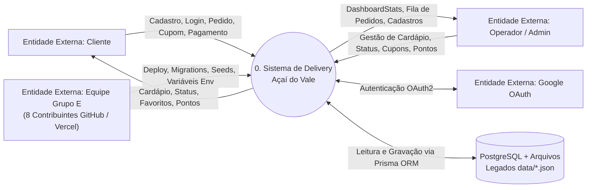
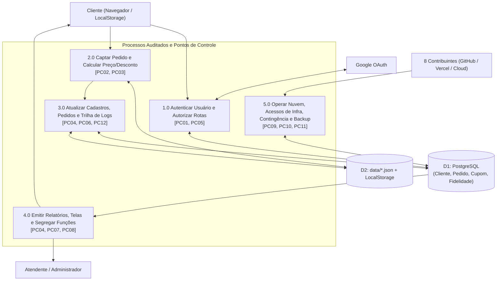

# Planejamento Consolidado, Mapeamento do Ambiente, DFD e Revisão de Supervisão

**Responsável:** Augusto Henrique (Pessoa 1 — Líder, Planejamento e Parecer)  
**Sistema Auditado:** Sistema de Delivery Digital *Açaí do Vale* (`acai_api` — **Grupo E**)  
**Período da Auditoria:** 24/11/2026 a 25/11/2026 | **Metodologia:** Prof. Eduardo Pelli — SASI / UFVJM

---

## 1. Conhecimento do Ambiente Auditado (1º Passo do Planejamento)

O levantamento combinou a inspeção estática do código-fonte e da documentação (`delivery-main/`), testes dinâmicos em ambiente local isolado e descartável, e o questionário respondido pelos integrantes do **Grupo E** em 24/11/2026 às 22h00.

| Dimensão do Ambiente | Situação Identificada na Auditoria |
| :--- | :--- |
| **Fluxo de Processamento** | **Entrada:** Cadastro/login (NextAuth ou JWT) e montagem de potes de açaí no cliente (`PedidoContext` / `localStorage`) com tamanho, sabores, adicionais, cupom, pagamento declarado e endereço. **Processamento:** Duas camadas coexistentes de API no Next.js 15: (i) rotas legadas acopladas diretamente ao Prisma (`/api/clientes`, `/api/pedidos`, `/api/sabores`, `/api/adicionais`, `/api/jwt/login`, `/api/seed`, `/api/create-admin`), usadas pelas telas principais; e (ii) rotas REST `/api/v1/*` parcialmente estruturadas em *Clean Architecture/DDD*. **Saída:** Indicadores resumidos no *Dashboard* (`DashboardStats`), fila operacional de pedidos, extrato de fidelidade e tela de acompanhamento pelo cliente. |
| **Recursos Humanos (Grupo E)** | Equipe de **8 contribuintes** identificados na coleta (Lucas Cordeiro Oliveira, Gabriel Guimarães de Castro, Ana Clara Rolim de Azevedo, Gabriel Vitor dos Santos Silva, Murilo Santiago Escobedo, Pávila Miranda Cardoso, Humberto Freire Pereira e Pedro Augusto Hackner Bittencourt). Não há designação formal de **Administrador de Dados (DBA)** nem de **Analista de Segurança da Informação**; na aplicação, operadores e gestores compartilham apenas a flag booleana `Cliente.isAdmin`. |
| **Recursos Materiais e Software** | **Produção declarada:** Aplicação hospedada na nuvem (**Vercel**), sem servidor físico próprio, e banco **PostgreSQL** gerenciado. **Desenvolvimento/Testes:** Containers Docker (`postgres:16-alpine` e `node:20-alpine`), Next.js 15.5.7, React 19.2.1, TypeScript 5, Prisma ORM 6.19.0, NextAuth 4.24.11, `bcryptjs` 3.0.2, `jsonwebtoken` 9.0.2, Jest 30.2 e suíte Java 17/Maven (`tests-java`). |
| **Arquivos e Armazenamento** | **SGBD PostgreSQL:** 11 modelos no `schema.prisma` (gerando 12 tabelas após as 8 *migrations*, incluindo `_prisma_migrations`): `Cliente`, `Pedido`, `Sabor`, `Adicional`, `PedidoSabor`, `PedidoAdicional`, `Cupom`, `Favorito`, `FavoritoSabor`, `FavoritoAdicional` e `FidelidadeTransacao`. **Arquivos legados e cliente:** 4 arquivos planos em `data/*.json` (usados em rotinas de *seed*) e estado financeiro editável em `localStorage` no navegador. |
| **Relatórios e Telas Produzidos** | **16 telas roteáveis (`page.tsx`) mapeadas** (13 de cliente/legado, com triplicidade de telas de login, e 3 painéis administrativos sobrepostos: `/dashboard`, `/dashboard/pedidos` e `/ui/admin`), **23 rotas de API (`route.ts`)** (8 em `/api/*` e 15 em `/api/v1/*`) e **4 saídas/relatórios operacionais** (`DashboardStats` com Receita Total, contadores de entregas, extrato de fidelidade e consulta de rastreamento `/pedidos/acompanhar`). |

---

## 2. Diagrama de Fluxo de Dados (DFD Top-Down — Elaborado pela Auditoria)

Constatada a ausência de DFD na documentação original do Grupo E (que continha apenas diagramas estruturais de classes/camadas e ER), a auditoria elaborou os DFDs Nível 0 e Nível 1 posicionando os **12 Pontos de Controle (`PC01` a `PC12`)** diretamente nos processos críticos.

### 2.1 DFD Nível 0 — Diagrama de Contexto

### 2.2 DFD Nível 1 — Processos e Localização dos Pontos de Controle (`PC01`–`PC12`)

---

## 3. Objetivos, Técnicas, Prazos, Custos e Nível de Tecnologia (3º Passo)

- **Objetivo Geral:** Validar e avaliar a aderência do sistema *Açaí do Vale* aos **8 parâmetros de Controle Interno** (fidelidade da informação, segurança física, segurança lógica, confidencialidade, obediência à legislação/LGPD, eficiência, eficácia e regras de negócio), fundamentando o **Certificado de Controle Interno** e o plano executivo de melhorias para a empresa auditada.
- **Técnicas Aplicadas:**
  1. *Questionário à distância* (enviado e respondido pelo Grupo E em 24/11/2026);
  2. *Análise do programa fonte e rastreamento de programas* (sobre o código `delivery-main/`, sem alterá-lo);
  3. *Simulação de dados (Test Deck)* em ambiente local isolado e descartável, cobrindo as 5 situações obrigatórias (*campos inválidos, valores nos limites, transações incompletas, incompatíveis e em duplicidade*);
  4. *Análise de relatórios, telas e auditoria de funções*;
  5. *Análise de rotinas de qualidade/logs e mapeamento de rotinas inativas* (`github/`, `husky/` e suíte Jest).
- **Limitação Metodológica Registrada:** Os testes funcionais e de integração foram executados exclusivamente em ambiente local descartável (`localhost`) com dados fictícios; o ambiente publicado na Vercel não foi submetido a cargas ou ataques, preservando integralmente a ética e a disponibilidade do sistema dos colegas.
- **Nível de Tecnologia:** Ferramentas especialistas próprias em Bash/Node (`test-deck.sh` e `test-deck-local.sh`), utilitários de inspeção PostgreSQL 17/Prisma e execução controlada da suíte Jest.
- **Orçamento de Custos e Indicador de Qualidade da Auditoria (Slide 30, Deck 1):**
  - Esforço total aplicado pela equipe: **35,0 horas-auditor** (7 integrantes × 5h00, custo de referência acadêmica de R\$ 80,00/h = **R\$ 2.800,00**).
  - **Indicador de Produtividade Apurado:**
    $$\text{Média de Horas por Ponto de Controle} = \frac{35,0\text{ horas aplicadas}}{12\text{ PCs validados}} = 2,92\text{ horas/PC}$$

---

## 4. Matriz Final Revisada e Hierarquizada dos 12 Pontos de Controle (2º, 4º, 5º e 6º Passos + Revisão de Papéis)

**Escala Oficial de Grau de Risco (Slide 19):** `1 – Muito Fraco` | `2 – Fraco` | `3 – Regular` | `4 – Forte` | `5 – Muito forte` *(maior valor = maior gravidade)*.

> **Registro da Revisão de Supervisão do Líder (4º Passo de Equipe):** Após a consolidação das evidências empíricas, dois pontos tiveram seu Grau de Risco **elevado** em relação à estimativa preliminar: **`PC05` (de 4 para 5 – Muito forte)**, devido à comprovação em teste de integração da emissão de JWT sem senha em `POST /api/jwt/login` com segredo de *fallback*; e **`PC11` (de 3 para 4 – Forte)**, diante da confirmação pelo Grupo E de inexistência total de rotina formal de backup e de testes de restauração do banco de dados. Também foi saneada a análise preliminar de `/api/seed`, que negou corretamente chamadas sem segredo (`HTTP 401`) no teste local, embora permaneça indevidamente ativa em produção segundo resposta do próprio Grupo E.

| Ordem | PC | Ponto de Controle Auditado | Parâmetro Principal Violado | Frente Responsável | Grau de Risco Final | Evidência Consolidada Pós-Execução |
| :---: | :---: | :--- | :--- | :--- | :---: | :--- |
| **1º** | **PC01** | Controle de Acesso Lógico às APIs e Rotas Admin (`/api/*`, `/v1/*`, `/seed`, `/create-admin`) | Segurança Lógica | **P3** (Alisson) | **5 – Muito forte** | `GET/POST/PUT/PATCH` em clientes, pedidos e admin aceitaram chamadas anônimas (`200`/`201`); Grupo E confirmou `/seed` e `/create-admin` ativos em produção. |
| **2º** | **PC02** | Programas de Cálculo e Consistência Financeira de Pedidos | Fidelidade & Regras de Negócio | **P4** (Helen) | **5 – Muito forte** | Servidor aceitou pedidos de R\$ −50,00, desconto de 99.999 sem cupom, potes vazios (`/api/pedidos`) e gerou pontos sobre valor arbitrário do cliente. |
| **3º** | **PC03** | Rotinas de Atualização de Cupons e Saldo de Fidelidade | Regras de Negócio & Segurança Lógica | **P4** (Helen) | **5 – Muito forte** | Criação/desativação anônima de cupons de 100%, crédito livre de 50.000 pts, saldo negativo (−9.999) e reuso de cupom único/inativo/inexistente no pedido. |
| **4º** | **PC05** | Gestão de Passwords, Emissão JWT (`/api/jwt/login`) e Redes | Segurança Lógica & Confidencialidade | **P3** (Alisson) | **5 – Muito forte** | `POST /api/jwt/login` emitiu JWT válido **sem validar senha**, aceitando segredo de *fallback* previsível; ausência confirmada de política formal de senhas. |
| **5º** | **PC04** | Confidencialidade de Telas/Rotas, Painéis e Dados Pessoais (LGPD) | Confidencialidade & Legislação | **P5** (Rafael) | **4 – Forte** | `GET /api/pedidos` sem sessão expôs endereços, e-mails, **hash `bcrypt` da senha e `isAdmin`**; proteção `AdminGuard` restrita ao cliente e `/ui/admin` sem guarda. |
| **6º** | **PC06** | *Audit Trail* (Logs), Tratamento de Erros e Rotinas de Qualidade/CI-CD | Fidelidade da Informação & Eficiência | **P4** (Helen) | **4 – Forte** | Mudança de status e exclusão física (`DELETE`) sem autor/trilha; 7 de 14 testes Jest falhando; pastas `github/` e `husky/` inativas (sem ponto inicial). |
| **7º** | **PC07** | Eficácia, Correção Contábil e Padronização de Relatórios e Telas | Eficácia & Fidelidade | **P5** (Rafael) | **4 – Forte** | `DashboardStats` soma todos os pedidos sem filtrar cancelados/período nem conciliar pagamentos; Grupo E confirmou ausência de conferência de totais. |
| **8º** | **PC11** | Rotinas de Backup e Recuperação de Transações no SGBD | Segurança Física/Lógica | **P2** (Ana Júlia e Mª Eduarda) | **4 – Forte** | Grupo E confirmou inexistência de backup formal do banco, sem periodicidade, sem responsável e **zero testes de restauração** realizados. |
| **9º** | **PC08** | Auditoria de Funções (RBAC/Setores) e Documentação Operacional | Políticas/Regras & Eficácia | **P5** (Rafael) | **3 – Regular** | Repasse entre atendimento, preparo e entrega reduzido a texto livre sem setor/horário/RBAC formal; ausência original de DFD e `.env.local.example`. |
| **10º** | **PC09** | Segurança do Local de Hospedagem e Governança de Acesso Cloud *(Ambiente Físico)* | Segurança Física | **P2** (Ana Júlia e Mª Eduarda) | **3 – Regular** | Hospedagem em nuvem (Vercel) delega segurança física ao provedor, porém os **8 contribuintes** acessam painéis sem papéis definidos e **sem 2FA obrigatório**. |
| **11º** | **PC10** | Continuidade Operacional, Rede/Estações e Gestão de Mudanças na `main` | Segurança Física & Eficiência | **P2** (Ana Júlia e Mª Eduarda) | **3 – Regular** | Dependência integral do SLA da Vercel sem procedimento escrito de *redeploy*/contingência; todos os 8 membros alteram a `main` sem revisão obrigatória de PR. |
| **12º** | **PC12** | Administração de SGBD, Unicidade, Dicionário e Precisão Monetária | Eficiência & Segurança Lógica | **P3** (Alisson) | **2 – Fraco** | Boa base estrutural (8 migrations, unicidade `P2002`, FKs `P2003` e `bcrypt`); ressalvas: ausência de DBA/dicionário, JSONs residuais e moeda em `Float`. |

---

## 5. Quadro Consolidado de Execução e Supervisão da Equipe Auditora

| Papel | Integrante(s) | Entregas Verificadas na Supervisão | Horas Orçadas | Horas Aplicadas |
| :---: | :--- | :--- | :---: | :---: |
| **P1** | **Augusto Henrique** | Planejamento, DFD, Supervisão/Revisão de Riscos, Relatório de Redução de Custos e Certificado de Controle Interno (`entrega_1/`) | 5h00 | 5h00 |
| **P2** | **Ana Júlia Silveira e Maria Eduarda Silveira** | Avaliação de Ambiente Físico/Cloud, Contingência e Backup (`PC09`, `PC10`, `PC11` em `entrega_2_6/`) | 5h00 *(2h30 cada)* | 5h00 *(2h30 cada)* |
| **P3** | **Alisson de Souza Rocha** | Testes de Integração de APIs, JWT/Senhas e SGBD PostgreSQL (`PC01`, `PC05`, `PC12` em `equipe/` e `evidencias/pessoa3/`) | 5h00 | 5h00 |
| **P4** | **Helen Gonçalves** | Simulação *Test Deck* (19 casos / 5 situações), Auditoria de Operação, Logs e Jest/CI-CD (`PC02`, `PC03`, `PC06` em `entrega_4/`) | 5h00 | 5h00 |
| **P5** | **Rafael Gomes** | Auditoria de Relatórios, Telas, Confidencialidade e Fluxo de Funções (`PC04`, `PC07`, `PC08` em `entrega_5/`) | 5h00 | 5h00 |
| **P6** | **Ana Júlia Silveira e Maria Eduarda Silveira** | Remessa/Coleta do Questionário Único (24 questões) junto ao Grupo E (WhatsApp, 24/11 às 22h00) e Pastas (`entrega_2_6/`) | 5h00 *(2h30 cada)* | 5h00 *(2h30 cada)* |
| **P7** | **José Inácio de Moraes Santos** | Compilação do Relatório de Fraquezas, Diagramação Final (`GRUPO_X.pdf` ≤ 20 págs) e Slides Executivos (≤ 15 min) | 5h00 | 5h00 |
| **TOTAL** | **7 Integrantes (5h00 totais por pessoa)** | **12 Pontos de Controle Validados + 5 Produtos da Auditoria** | **35h00** | **35h00** |
